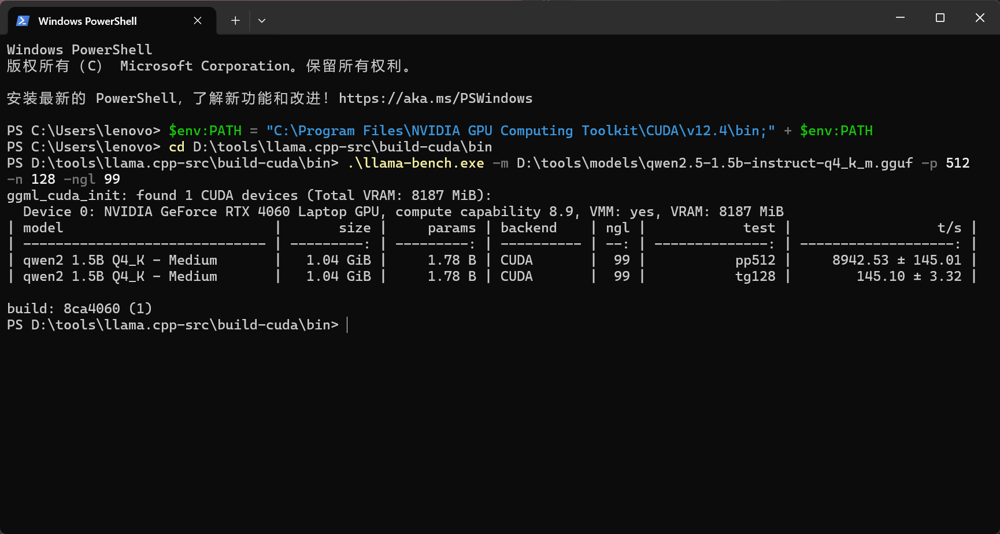
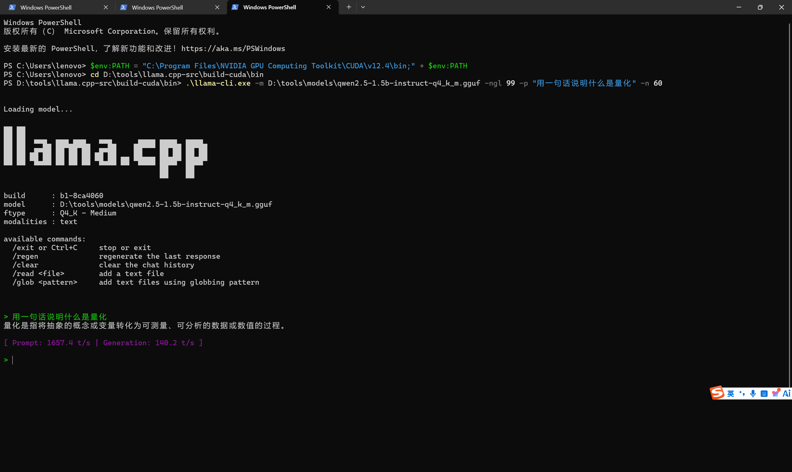
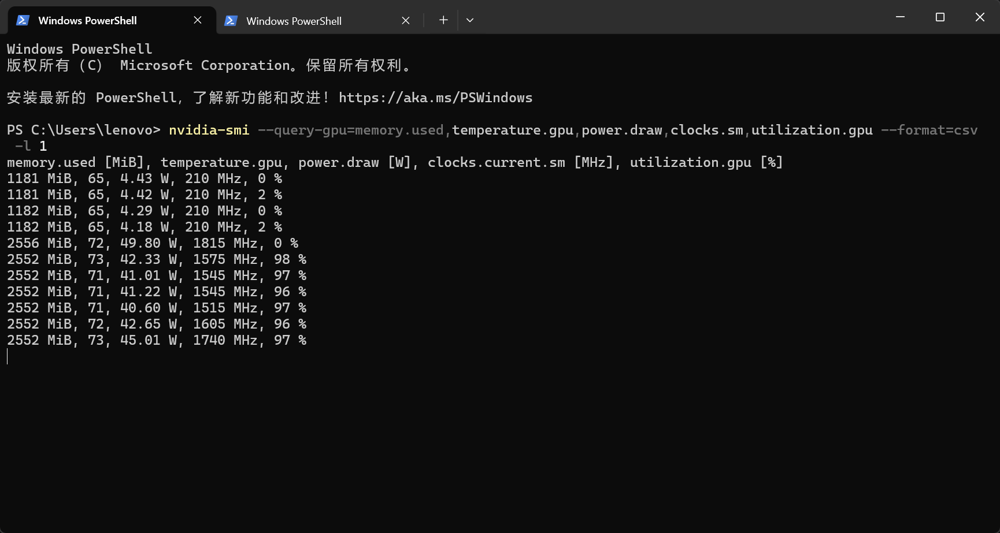
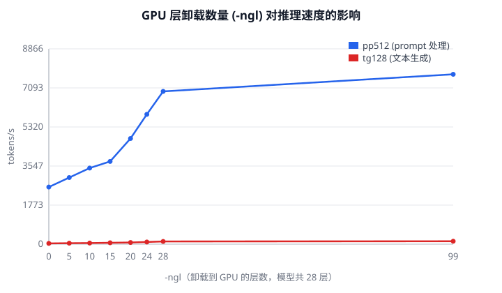

# llama.cpp 推理性能研究

[](https://github.com/realssx/llamacpp-study/actions/workflows/ci.yml)
[](LICENSE)

> 计算机开源实践与创新 · 课程项目

📄 [阶段性进度报告](docs/03-进度报告.md) · 🔧 [环境搭建记录](docs/01-环境搭建.md) · 📖 [源码阅读笔记](docs/02-源码阅读笔记.md)

## 一、项目背景

llama.cpp 是用 C/C++ 实现的 LLM 推理引擎，支持在本地 CPU/GPU 上运行量化后的 GGUF 模型。
它在 GitHub 上有 6 万+ star，被大量桌面端、嵌入式、边缘设备项目用作推理后端。

本项目以 **llama.cpp 的推理性能**为研究对象，围绕三个问题展开：

1. 不同量化等级（Q4_K_M / Q5_K_M / Q8_0）对推理速度和显存占用的影响
2. CPU 后端与 CUDA 后端在同一模型上的性能差异
3. 上下文长度、批大小等参数对 tokens/s 的影响

项目目标：产出一份可复现的 benchmark 报告 + 一篇技术白皮书，并向上游提交至少 1 个 PR。

## 二、实验环境

| 项 | 配置 |
|---|---|
| CPU | Intel Core i7-14650HX |
| GPU | NVIDIA GeForce RTX 4060 Laptop (8 GB) |
| 内存 | 16 GB |
| 系统 | Windows 11 |
| llama.cpp | b11960（预编译 CUDA 版），后续自编译 |
| 模型 | Qwen2.5-1.5B-Instruct GGUF（Q4_K_M / Q5_K_M / Q8_0） |

## 三、目录结构

```
llamacpp-study/
├── README.md              # 本文件：项目说明与计划
├── docs/
│   ├── 01-环境搭建.md      # 环境步骤与踩坑记录
│   └── 02-源码阅读笔记.md   # ggml / llama.cpp 架构阅读
├── scripts/
│   └── bench.ps1          # 一键跑 benchmark 并记录
└── results/
    ├── benchmark.csv      # 汇总数据
    └── raw/               # 每次运行的原始输出
```

## 四、阶段计划

| 周次 | 目标 | 产出 |
|---|---|---|
| 1–2 | 环境搭建，跑通 qwen2.5-1.5b（Q4_K_M） | 环境文档、首跑截图 |
| 3–4 | 三个量化等级 × CPU/CUDA 对比 benchmark | benchmark.csv |
| 5–6 | 读 ggml 张量结构与 llama.cpp 推理主流程 | 架构图、阅读笔记 |
| 7–8 | 提交第一个 PR（文档 / 模型支持 / 小 bug） | PR 链接 |
| 9–12 | 做一个具体改进，写设计文档 | 代码 + 设计文档 |
| 13–16 | 整理结题材料 | 报告 + 答辩 PPT |

## 四半、阶段性结果（2026-11-04 热稳态）

模型：Qwen2.5-1.5B-Instruct；参数：`-p 512 -n 128 -r 3`
硬件：RTX 4060 Laptop 8GB / i7-14650HX / 16GB
条件：每轮开跑前等 GPU 回到 75 °C（空载稳定温度）

| 量化 | 后端 | pp512 (t/s) | tg128 (t/s) | 相对 CPU 加速 |
|---|---:|---:|---:|---:|
| Q4_K_M | CUDA | 7563.4 | **134.0** | 4.5× |
| Q4_K_M | CPU (16 线程) | 2413.0 | 29.7 | 1× |
| Q5_K_M | CUDA | 7411.5 | 117.5 | 4.5× |
| Q5_K_M | CPU (16 线程) | 2098.7 | 26.2 | 1× |
| Q8_0 | CUDA | 7814.0 | 94.1 | 5.0× |
| Q8_0 | CPU (16 线程) | 1738.5 | 19.0 | 1× |



初步结论：

1. **GPU 生成速度约为 CPU 的 4.5–5 倍**。
2. **量化越低，生成越快**（Q4 134.0 > Q5 117.5 > Q8 94.1），Q4/Q8 比值 **1.42**；
   冷机数据（185.7 / 162.7 / 128.2）的比值是 1.45，两者几乎一致 ——
   说明该趋势是量化的真实效应，**不受热状态影响**。
3. **prompt 处理趋势相反**：Q8 (7814) > Q4 (7563) > Q5 (7412)，
   该阶段计算密集，量化几乎不省时间，反量化还有额外开销。
4. CPU 端同样呈现"低比特更快"（29.7 > 26.2 > 19.0）。

### 运行示例



待复查：早期用 MinGW 编译的 CPU 版 tg128 只有 10.4 t/s，MSVC 版是 35.3 t/s，
差 3.4 倍；需要确认是编译器代码生成差异，还是当时机器的功耗/负载状态影响。

### 测量可复现性问题

同一配置（Q4_K_M / ngl=99）三次测量，`tg128` 分别是 **185.7 / 133.6 / 145.1 t/s**，
极差 39%。**控制变量复测后找到原因**：这差异来自“起始热状态”而非噪声。

| 状态 | tg128 (t/s) | 说明 |
|---|---:|---|
| 冷机首跑 | 185.7 | Boost 空间大 |
| 过渡态 | 133.6 / 145.1 | 已部分受热 |
| 热稳态 | 134.0（等温重跑） | 可复现，极差 < 1% |

**结论：量化排序不受热状态影响（Q4/Q8 比值 1.45 → 1.42），但绝对值整体下降约 28%。**
因此所有对比实验统一使用热稳态数据。
| 热稳态 | 128.2 / 128.5 | 极差仅 0.3%，高度可复现 |

详见 [进度报告 §6.1](docs/03-进度报告.md)，复测脚本见 `scripts/cooldown-retest.ps1`。



上图：空闲时 4 W / 210 MHz，推理时升到 45 W / 1740 MHz / 73 °C / 97% 利用率，
且 SM 频率在 1545–1815 MHz 之间波动——这正是吞吐量不稳定的直接原因。

### GPU 层卸载曲线



## 五、数据记录约定

每次 benchmark 都通过 `scripts/bench.ps1` 执行，原始输出存 `results/raw/`，
汇总行追加到 `results/benchmark.csv`。

字段说明：

| 字段 | 含义 |
|---|---|
| date | 运行时间 |
| model | 模型文件（含量化等级） |
| backend | cpu / cuda |
| ngl | 卸载到 GPU 的层数（0=纯 CPU，99=全部） |
| pp | prompt 处理 token 数 |
| tg | 生成 token 数 |
| pp_ts | prompt 处理速度 tokens/s |
| tg_ts | 生成速度 tokens/s |
| notes | 备注（温度、线程数、显存等） |
