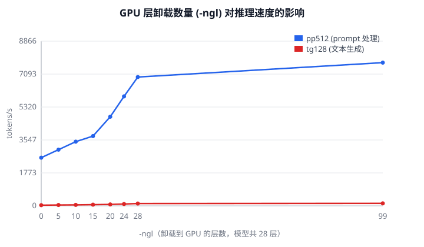

# 计算机开源实践与创新 · 阶段性进度报告

| 项目 | 内容 |
|---|---|
| 选题 | 基于 llama.cpp 的大模型本地推理性能研究 |
| 阶段 | 第一学期 · 阶段性进度 |
| 日期 | 2026-11 |

---

## 一、选题背景与意义

随着大语言模型从云端走向本地，如何在消费级硬件上高效运行模型成为工程上的关键问题。
`llama.cpp` 是用 C/C++ 实现的开源推理引擎，也是当前本地部署的事实标准之一：

- GitHub 6 万+ star，被大量桌面端、嵌入式、边缘设备项目作为推理后端
- 采用纯 C/C++ 实现，不依赖深度学习框架，适合研究推理链路的底层机制
- 支持多种量化格式（Q4_K / Q5_K / Q8_0 等）和多种后端（CPU / CUDA / Vulkan / Metal）

选择该项目的理由：

1. **与我的能力衔接**：刚完成 Linux 0.11 内核实验，具备 C 语言和操作系统基础，
   阅读 ggml 的张量与内存管理代码门槛较低
2. **可量化**：推理速度（tokens/s）、显存占用都是硬指标，实验结果客观
3. **可参与**：项目维护活跃，有 `good first issue` 标签，具备向上游提交 PR 的通道

**研究问题**：

> 在 RTX 4060 Laptop（8 GB 显存）这样的消费级硬件上，量化等级与后端选择
> 对推理性能的影响规律是什么？瓶颈分别在显存带宽还是算力？

---

## 二、研究内容与目标

| 阶段 | 目标 |
|---|---|
| 本学期 | 完成环境搭建与基线测量，产出可复现的实验数据 |
| 下学期 | 深入源码，完成至少一个能被合并的 PR，产出技术白皮书 |

具体任务：

1. 在 Windows + RTX 4060 环境下从源码编译 llama.cpp（CPU / CUDA 双后端）
2. 测量不同量化等级（Q4_K_M / Q5_K_M / Q8_0）在两个后端上的推理速度
3. 测量 GPU 层卸载数量（`-ngl`）与速度的关系，定位瓶颈
4. 阅读源码，理解 `llama_decode` 的建图与调度流程
5. 向 llama.cpp 上游提交至少 1 个 PR

---

## 三、实验环境

| 项 | 配置 |
|---|---|
| CPU | Intel Core i7-14650HX（16 核 24 线程） |
| GPU | NVIDIA GeForce RTX 4060 Laptop（8 GB，compute capability 8.9） |
| 内存 | 16 GB |
| 操作系统 | Windows 11 |
| 编译器 | MSVC 14.44（VS Build Tools 2022） |
| CUDA | 12.4.99 |
| 构建系统 | CMake 4.4 + Ninja |
| llama.cpp | commit 8ca4060（v0.8.0 系列） |
| 模型 | Qwen2.5-1.5B-Instruct（Q4_K_M / Q5_K_M / Q8_0） |

---

## 四、已完成工作

### 4.1 环境搭建

GitHub 直连不可用、公共加速镜像限速严重（实测 8–270 KB/s 且不稳定），
因此最终采用 **国内镜像获取源码 + 本地编译** 的方案：

```
gitcode.com 镜像克隆源码（16 秒）
  → MinGW gcc 16.1 + Ninja 编译 CPU 版（6 分钟）
  → 安装 MSVC + CUDA Toolkit，编译 CUDA 版（约 15 分钟）
```

过程中解决的问题（均为可复现的典型问题）：

| 问题 | 现象 | 原因与解决 |
|---|---|---|
| MinGW 编译失败 | `cpp-httplib doesn't support Windows 8 or lower` | 默认 `_WIN32_WINNT` 过低，加 `-D_WIN32_WINNT=0x0A00` |
| CMake 找不到 CUDA | `Could not find nvcc` | 指定 `-DCUDAToolkit_ROOT` |
| VS 生成器报错 | `No CUDA toolset found` | 缺 CUDA 的 VS 集成组件，改用 Ninja + `vcvars64.bat` |
| 链接失败 | `Target "ggml-cuda" links to: CUDA::cublas` | 只装了 nvcc/cudart，补装 cublas |

> 完整步骤记录见 `docs/01-环境搭建.md`。

### 4.2 量化等级 × 后端基线实验

参数：`-p 512 -n 128 -r 3`（prompt 512 token，生成 128 token，重复 3 次取均值）

| 量化 | 后端 | pp512 (t/s) | tg128 (t/s) | 相对 CPU 加速 |
|---|---|---:|---:|---:|
| Q4_K_M | CUDA | 9068.4 | **185.7** | 5.3× |
| Q4_K_M | CPU (16 线程) | 2882.4 | 35.3 | 1× |
| Q5_K_M | CUDA | 9395.4 | 162.7 | 5.4× |
| Q5_K_M | CPU (16 线程) | 2612.9 | 30.1 | 1× |
| Q8_0 | CUDA | 10608.7 | 128.2 | 6.0× |
| Q8_0 | CPU (16 线程) | 2072.6 | 21.4 | 1× |

原始数据：`results/benchmark.csv`，每次运行的完整输出在 `results/raw/`。

### 4.3 GPU 层卸载实验

固定 Q4_K_M，改变 `-ngl`（卸载到 GPU 的层数，模型共 28 层）：

| ngl | 0 | 5 | 10 | 15 | 20 | 24 | 28 | 99 |
|---|---:|---:|---:|---:|---:|---:|---:|---:|
| pp512 (t/s) | 2593 | 3025 | 3456 | 3755 | 4798 | 5892 | 6935 | 7710 |
| tg128 (t/s) | 35.2 | 45.2 | 52.2 | 62.9 | 77.0 | 99.4 | 124.7 | 133.6 |



---

## 五、阶段性结论

1. **GPU 生成速度约为 CPU 的 5–6 倍**，且量化等级越低差距越大。
2. **生成速度随量化比特数下降而提升**（Q4 185.7 > Q5 162.7 > Q8 128.2），
   符合“自回归生成受显存带宽限制”的预期：权重越小，每步读取的数据量越少。
3. **prompt 处理速度趋势相反**（Q8 10609 > Q5 9395 > Q4 9068），
   说明该阶段是计算密集而非带宽密集，量化带来的反量化开销抵消了减少数据量的收益。
   → 两个指标趋势相反，是本阶段最有价值的观察。
4. **层卸载存在明显边际效应**：`ngl` 从 0 到 28，生成速度提升 3.5 倍；
   但 24 层之后收益开始放缓（24→28 仅提升 25%），说明瓶颈逐渐从 GPU 算力转移。
5. **性能波动不可忽略**：同一配置（Q4_K_M / ngl=99）两次测量得到 185.7 与 133.6 t/s，
   相差约 28%。推测与笔记本 GPU 的功耗墙和温度墙有关，后续需控制测量条件。

---

## 六、遇到的问题与分析

### 6.1 同一配置测量结果差异大

现象：`tg128` 两次测量分别为 185.7 和 133.6 t/s。

初步分析：

- 笔记本 GPU 存在动态功耗分配，长时间跑分后会降频
- 两次测量的环境温度、是否接通电源未知

后续措施：记录 GPU 温度和频率（`nvidia-smi --query-gpu=clocks.sm,temperature.gpu`），
每次测量前静置降温，或固定百分比的风扇转速。

### 6.2 MinGW 与 MSVC 的 CPU 性能差异

现象：MinGW 编译的 CPU 版 `tg128` 为 10.4 t/s，MSVC 编译为 35.3 t/s，相差 3.4 倍。

待验证：是编译器对 SIMD intrinsic 的代码生成差异，还是测量时的机器状态差异。
计划用同一台机器、同一模型、交替跑三次来排除。

---

## 七、下学期计划

| 时间 | 任务 | 产出 |
|---|---|---|
| 第 1–2 周 | 控制变量的复测（温度、频率记录） | 修正后的数据表 |
| 第 3–4 周 | 读 `ggml` 与 `llama.cpp` 源码 | 架构图、阅读笔记 |
| 第 5–6 周 | 提交第一个 PR（文档或小 bug） | PR 链接 |
| 第 7–10 周 | 做一个性能或功能改进 | 代码 + 设计文档 |
| 第 11–14 周 | 撰写技术白皮书 | 白皮书初稿 |
| 第 15–16 周 | 结题材料整理 | 报告 + 答辩 PPT |

---

## 八、参考与链接

- llama.cpp 仓库：<https://github.com/ggml-org/llama.cpp>
- 镜像：<https://gitcode.com/gh_mirrors/ll/llama.cpp>
- 模型：<https://modelscope.cn/models/Qwen/Qwen2.5-1.5B-Instruct-GGUF>
- 项目内文档：`docs/01-环境搭建.md`、`docs/02-源码阅读笔记.md`
- 原始数据：`results/benchmark.csv`、`results/ngl-sweep.csv`、`results/raw/`
